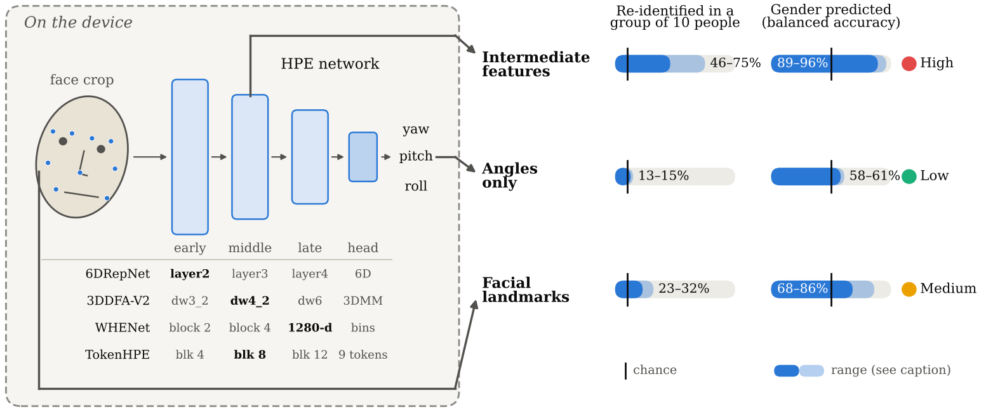

<h1 align="center">What Do Head Pose Estimators Reveal?</h1>
<p align="center"><b>An Audit of Identity and Soft-Biometric Leakage in Head Pose Pipelines</b></p>
<p align="center">
Tunahan Parlayıcı · Erchan Aptoula · Yücel Saygın<br>
Sabancı University
</p>
<p align="center">
<a href="https://USERNAME.github.io/hpe-pp/">Project page</a> ·
Paper (under review) ·
<a href="#citation">BibTeX</a>
</p>

<p align="center"></p>

Head pose estimation (HPE) is often regarded as privacy-friendly because its output is three angles. We test this in two scenarios: only the outputs of the HPE pipeline leave the device, or a protected face image is shared. We audit **6DRepNet, 3DDFA-V2, WHENet and TokenHPE** on two disjoint LFW identity sets, CelebA and FairFace, with decision rules fixed before each run.

## Key findings

| What leaves the device | Re-identified in a group of 10 (chance 10%) | Gender, CelebA (chance 50%) |
|---|---|---|
| Intermediate features (best layer) | 46–75% | 89–96% |
| Facial landmarks | 23–32% | 68–86% |
| Angles only | 13–15% | 58–61% |

- Intermediate features of the CNN estimators identify people at **24–29× chance**, the level of an ImageNet ResNet-50; TokenHPE reaches **63×**. Pose training lowers identity relative to the ViT it starts from, but does not remove it.
- On FairFace, the same features predict perceived race and age group at **2.5–3.8× chance**; angles stay at chance.
- **TIP-IM and AMT-GAN** keep pose but leave 78–88% of ArcFace accuracy. An alignment-aware ensemble attack that defeats ArcFace still leaves **34–48%** of the identity signal in HPE features. Blurring and pixelation hide identity only when pose is destroyed.
- A linear projection that removes identity directions either breaks pose or leaves a retrained attacker at 23–68× chance.

**Recommendation:** process images on the device, release angles only, and treat intermediate features, landmarks and 3DMM shape coefficients as biometric data.

## Code

The analysis code, the pre-specified decision rules and per-run reports will be released here with the paper. Classifiers trained for the soft-biometric measurements will not be released.

## Ethics

Only public datasets are used (LFW, CelebA, CelebA-HQ, FairFace). FairFace race and age labels are perceived categories; they are used only to measure aggregate risk, with no comparisons across groups.

## Citation

```bibtex
@article{parlayici2026hpepp,
  title   = {What Do Head Pose Estimators Reveal? An Audit of Identity
             and Soft-Biometric Leakage in Head Pose Pipelines},
  author  = {Parlay{\i}c{\i}, Tunahan and Aptoula, Erchan and Sayg{\i}n, Y{\"u}cel},
  note    = {Under review},
  year    = {2026}
}
```

## Acknowledgment

This work was supported by TÜBİTAK under the 2244 Industrial PhD Fellowship Program.
